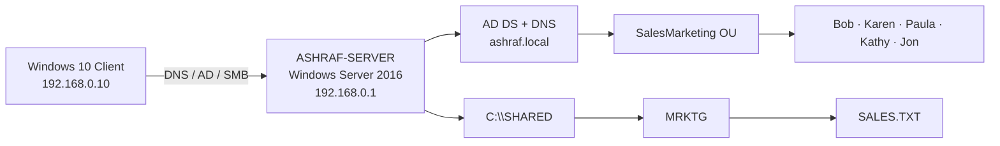

# Windows Server 2016 Active Directory & Security Lab

This project documents my Windows Server 2016 lab, where I configured Active Directory, DNS, Group Policy, NTFS permissions, and file auditing.

> **Project status:** Tasks 1–3 complete. Task 4 (Group Policy software publishing) is intentionally left as **Pending** until it is completed in the lab.

## Lab Architecture



### Environment

| Component | Configuration |
|---|---|
| Server OS | Windows Server 2016 Datacenter |
| Server name | `ASHRAF-SERVER` |
| Server IPv4 | `192.168.0.1/24` |
| Server DNS | `127.0.0.1` |
| Active Directory domain | `ashraf.local` |
| NetBIOS domain | `ASHRAF` |
| Client OS | Windows 10 |
| Client IPv4 | `192.168.0.10/24` |
| Client DNS | `192.168.0.1` |
| Department OU | `SalesMarketing` |
| Users | Bob, Karen, Paula, Kathy, Jon |

## What I Implemented

### Task 1 — Active Directory, User Controls, Profiles & GPO

- Installed **Active Directory Domain Services** and promoted the server to a domain controller for `ashraf.local`.
- Configured DNS and verified domain connectivity from a Windows 10 client.
- Created the **SalesMarketing** organizational unit.
- Created domain users: **Bob, Karen, Paula, Kathy, and Jon**.
- Restricted logon hours to **Monday–Friday, 8:00 AM–6:00 PM**.
- Configured roaming profile storage under `\\ASHRAF-SERVER\Profiles`.
- Configured account lockout policy for **3 invalid attempts**, with a **30-minute lockout duration** and **30-minute counter reset**.
- Created a user-targeted GPO named **Hide Control Panel - Kathy**.
- Applied the Control Panel restriction only to Kathy using security filtering.
- Verified client-to-server connectivity and DNS resolution.

Evidence folder: [`screenshots/task1-ad-and-gpo`](screenshots/task1-ad-and-gpo/)

### Task 2 — NTFS, Share Permissions & Effective Access

Created the following hierarchy:

```text
C:\SHARED
└── MRKTG
    └── SALES.TXT
```

The root `SHARED` folder was configured without inherited user permissions, then explicit permissions were applied. `MRKTG` inherited from `SHARED` and received additional explicit Allow/Deny entries. `SALES.TXT` inherited from its parent and received a direct Read entry for Jon.

#### Permission design

| Object | Bob | Karen | Paula | Kathy | Jon |
|---|---|---|---|---|---|
| `SHARED` direct | R, W, L, RE | L | R, L | M, RE, L, R, W | L |
| `MRKTG` direct | Deny W | Deny L | Allow M / W / RE | Deny R / L / RE | Allow W + Deny L |
| `SALES.TXT` direct | — | — | — | — | Allow R |

Legend: **R** Read, **W** Write, **L** List folder contents, **RE** Read & Execute, **M** Modify.

The folder was also exposed as a network share at:

```text
\\ASHRAF-SERVER\SHARED
```

I used Everyone: Full Control on the share and controlled access mainly with NTFS permissions. I also checked Effective Access for all five users to confirm the final permissions.

Evidence folder: [`screenshots/task2-permissions`](screenshots/task2-permissions/).

### Task 3 — File Access Auditing & Event Viewer

- Enabled **Audit object access** for both **Success** and **Failure**.
- Added a SACL auditing entry on `SALES.TXT` for **Everyone**.
- Set the auditing type to **All** and selected **Full control** to audit all access types.
- Generated real file access from the client environment.
- Reviewed the **Security** event log in Event Viewer.
- Filtered for **Event ID 4663** to identify object-access events.
- Verified the event subject account and access activity associated with the audited file.

Evidence folder: [`screenshots/task3-auditing`](screenshots/task3-auditing/)

## Validation Performed

| Test | Result |
|---|---|
| Ping from Windows 10 to `192.168.0.1` | Passed |
| `nslookup ashraf.local` | Resolved to `192.168.0.1` |
| Domain secure channel | Verified successfully |
| Access to `\\ASHRAF-SERVER\SHARED` | Passed |
| Effective Access for Bob | Validated |
| Effective Access for Karen | Validated |
| Effective Access for Paula | Validated |
| Effective Access for Kathy | Validated |
| Effective Access for Jon | Validated |
| Security audit event generation | Verified with Event ID `4663` |

See [`docs/testing.md`](docs/testing.md) for the verification checklist.

## Skills Used in This Lab

- Active Directory domain administration
- Organizational Units and domain user management
- DNS integration with AD DS
- Group Policy configuration and security filtering
- Account lockout policy
- Logon-hour restrictions
- Roaming profiles
- NTFS inheritance
- Explicit Allow and Deny ACEs
- Share vs. NTFS permission interaction
- Effective Access validation
- SACL-based file auditing
- Windows Security Event Log analysis

## Repository Structure

```text
.
├── README.md
├── docs/
│   ├── lab-notes.md
│   ├── permission-matrix.md
│   ├── screenshots.md
│   └── testing.md
├── scripts/
│   └── verify-lab.ps1
└── screenshots/
    ├── task1-ad-and-gpo/
    ├── task2-permissions/
    └── task3-auditing/
```

## Task 4 — Pending

The remaining course task covers creating and sharing an `application` folder and publishing a course-provided MSI through Group Policy to selected users while excluding Kathy and Karen. Task 4 is still pending because I have not completed that part of the lab yet.

## Notes

This repository contains only my lab documentation and screenshots. The domain, user accounts, and IP addresses are used only for this lab. VM files, ISO files, course binaries, assignment files, and textbook material are not included.
